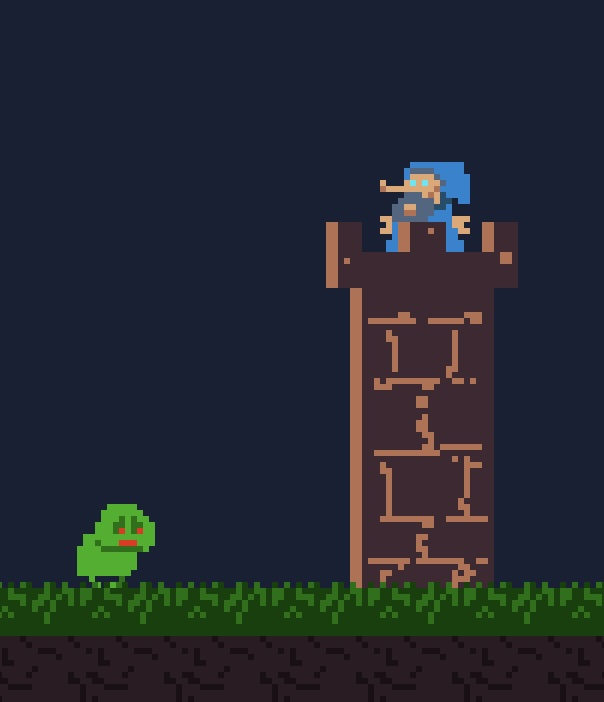

# Wizard's Tower



A small canvas game loop with native JavaScript modules. No build step or npm dependencies.

## Wizard voice samples

Generate retro wizard speech with `python3 tools/voice/generate.py` (macOS,
Python 3.9+, no dependencies). Audition the included samples at
[assets/audio/wizard/](assets/audio/wizard/index.html) when running the local
server. Three presets explore toy-computer, cartridge, and deep robot voices.
See [the voice workshop](tools/voice/README.md) for custom lines, batch generation,
WAV processing, and tuning.

## Run locally

From this directory:

```sh
python3 -m http.server 8000 --bind 127.0.0.1
```

Open http://127.0.0.1:8000. Use a local server instead of opening index.html as a file, because the browser loads JavaScript modules over HTTP.

Click **Start game** to begin with sound enabled. Until then, the game waits on
the start screen without advancing timers or spawning enemies. Once started,
you should see a tower, a wizard, an approaching ork, terrain, and a live FPS counter.

The `new Game(320, 180, true, "Wizard's Tower", 5)` call at the bottom of
`js/game.js` sets the logical scene size and display zoom. A zoom of 5 displays
the entire 320×180 scene at up to 1600×900 pixels, shrinking to fit the browser.
Changing zoom changes the display size without cropping the scene.

The **Start game** click unlocks a shared Web Audio context and plays the wizard's
welcome line so later game events can play samples. Use **Mute sound** to mute,
then **Enable sound** to turn it back on. If audio cannot be enabled, the game
still starts and **Enable sound** lets you retry.

## How it works

- `js/game.js` contains the `Game` class, which creates the canvas, initializes the scene, and owns the game loop.
- `Game.start()` and `Game.stop()` resume and pause the loop.
- `Game.frame(timestamp)` schedules the next frame, measures time and FPS, then calls `update(dt)` followed by `render()`.
- `Game.update(dt)` advances entities and processes their events. Its `dt` argument is seconds since the previous frame, capped at 0.05 after long pauses.
- `Game.render()` draws the background, FPS counter, and entities.
- `js/core/game.entity.js` defines the entities and their individual update and render behavior.
- `js/utils/utils.canvas.js` handles high-density canvas resolution.

There is no target-FPS throttle: rendering follows the display refresh rate, while sprite animation uses elapsed time. The counter measures rendered frames per second.

In the browser console, `game.stop()` pauses and `game.start()` resumes. The Pause and Resume buttons call these same methods. Repeated starts do not create extra loops.

For future entities, add objects to `game.state.entities`, each with `update(dt, emit)` and `render(context)` methods. `Game.update()` mutates state in place, and entities can use `emit(event)` to queue events for the game to process.
